# RV Prediction Pipeline
<!-- https://colab.research.google.com/drive/1HzD56hiNY-XLyJrHfkCuGJGCMbPixTWa?usp=sharinguv -->
>  Deployment URL:  <br> https://fins5557-project-git-918360163792.europe-west1.run.app 
> ---
> **Note:** Running our entire application on Google Cloud Run with 2 CPUs and 2 GB of memory has introduced a few major bottlenecks. Because the server scales down to zero after 20 minutes of inactivity, any new visitor triggers a lengthy cold start. During this downtime, the workspace is completely wiped, meaning all stored content, registered accounts, and loaded models disappear. Furthermore, because the environment only has 2 GB of RAM, running the model too frequently pushes the container past its memory limit, causing the server to crash due to out-of-memory errors.


<!-- You are an expert AI tutor for the course \"FINS5557 Applied AI in Finance\". Course description: This course explores how AI is making transformative impact in the global financial sector and equips students with the knowledge and skills needed to succeed at the intersection of AI and finance. Topics of interests include, but not limited to AI in banking automation, predictive analytics for market intelligence, risk management and fraud detection, corporate finance, algorithmic trading, as well as asset and wealth management.. Relevant excerpts from the course materials will be provided with each student message. When drawing on them, cite the source naturally — e.g. \"according to the week 1 slides\" or \"as covered in the AI regulation reading\". Never say \"Excerpt N\" or reference a chunk number. Relate concepts to real-world finance scenarios. If a question is outside the course scope, redirect the student politely -->


A robust, extensible machine learning pipeline for predicting future realized volatility regimes as a binary classification problem.

This project provides an end-to-end workflow for:

- Loading financial market data from `yfinance`
- Falling back automatically to synthetic data when live data is unavailable
- Building volatility, price, macro, GARCH, HAR-RV, and Kalman-based features
- Constructing forward realized volatility targets and binary labels
- Training multiple machine learning models with time-series cross-validation
- Tuning models using Optuna
- Saving reproducible experiment artifacts
- Evaluating predictions with probabilistic metrics, baselines, regime analysis, visualizations, and LLM-assisted reporting

<!-- [INSERT GRAPH] -->

---

## 1. Project Overview

The pipeline is designed for realized volatility prediction in financial markets. Given historical OHLCV data and optional market context variables such as VIX, VVIX, SKEW, interest rates, dollar index, and gold prices, the system builds a feature matrix and predicts whether future realized volatility will be above a historical threshold.

The prediction task is formulated as:

> Will the forward realized volatility over the next `horizon` days be higher than its expected expanding benchmark? [Review code](./project/src/features/core.py)

This produces a binary label:

- `y = 1`: future realized volatility is high
- `y = 0`: future realized volatility is low or normal

The system supports both command-line execution and Python API usage. A Streamlit workbench is also available for interactive experimentation.

---

## 2. Key Strengths

This project emphasizes robustness, reproducibility, and interpretability.

### Robust Data Handling

- Uses `yfinance` for real market data
- Automatically falls back to synthetic data if market data cannot be downloaded
- Caches data and run artifacts for reproducibility

### Strong Feature Engineering

The pipeline includes a large set of built-in financial features:

- Historical realized volatility
- OHLC-based volatility estimators
- Downside risk features
- Volatility-of-volatility features
- VIX and macro-market indicators
- Calendar effects
- GARCH-family volatility forecasts
- HAR-RV forecasts
- Kalman filter trend and residual features

### Time-Series-Safe Training

- Uses time-series cross-validation
- Supports purge/gap between training and validation windows
- Avoids look-ahead leakage through shifted features
- Supports rolling train/test windows

### Model Flexibility

- Model registry design
- Supports Logistic Regression, XGBoost, and LightGBM
- Easy to add new models
- Uses Optuna for hyperparameter optimization

### Rich Evaluation

- Out-of-fold prediction evaluation
- Brier score and log-loss
- Diebold-Mariano tests against baselines
- Regime-based confusion matrices
- VIX-based macro regime clustering
- Evaluation plots
- LLM-assisted diagnostic briefing

<!-- | | |
|--|--|
|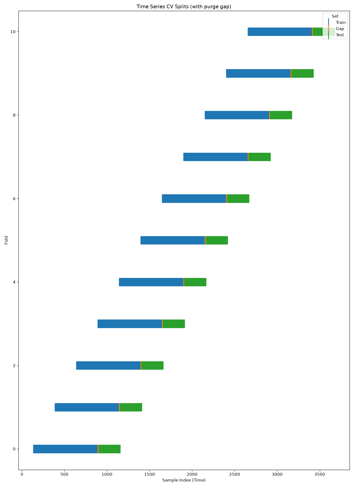|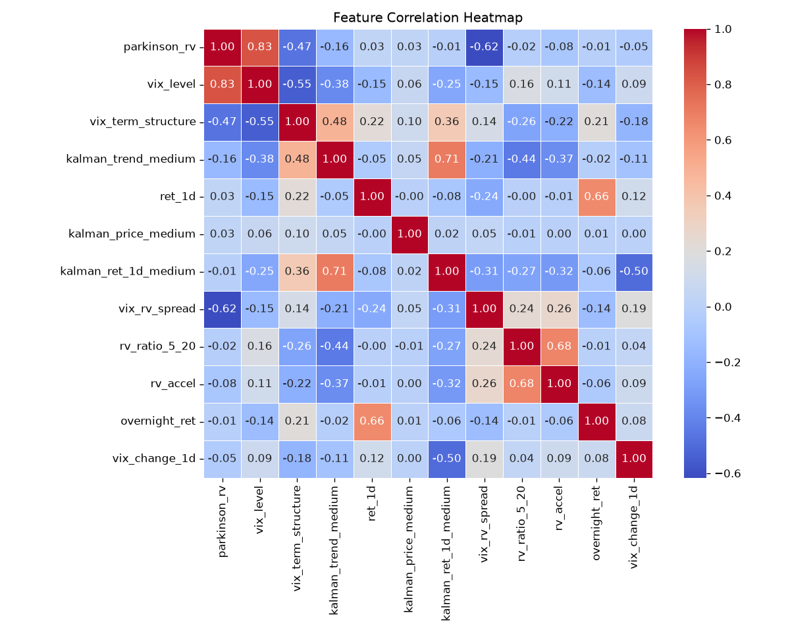 |
|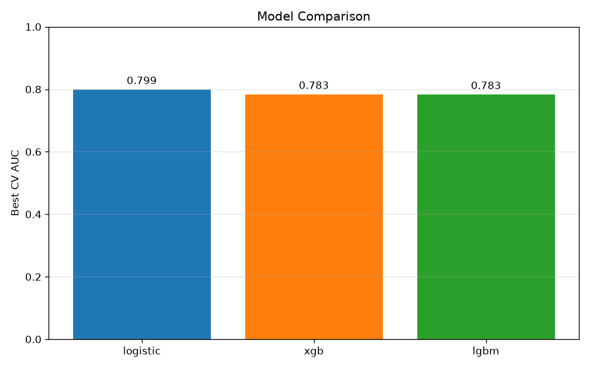|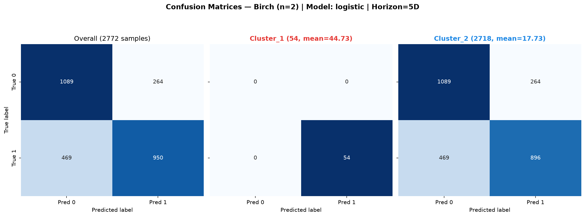| -->


---

## 3. Project Structure

```text
project/
├── train.py                  # CLI entry point for model training
├── eval.py                   # CLI entry point for evaluation
├── main.py                   # One-click train + evaluate workflow
├── app.py                    # Streamlit workbench entry point
├── prompts/
│   └── eval_llm_prompts.md   # LLM report generation prompts
├── cache/
│   ├── data/                 # Shared data cache
│   └── runs/                 # Per-run artifacts
└── src/
    ├── data/                 # Data loading and synthetic data generation
    ├── features/             # Feature engineering and feature selection
    ├── models/               # Model registry, tuning, fitting, evaluation
    ├── metrics/              # Probabilistic metrics, baselines, DM test
    ├── eval/                 # Evaluation reports, plots, regime analysis
    ├── evaluation/           # Stable external evaluation API
    ├── streamlit_app/        # Streamlit adapter layer
    └── utils/                # Cache and artifact utilities
```

---

## 4. Installation

This project is designed to run with `uv`.

```bash
cd project
uv sync
```

Optional environment variables can be placed in a `.env` file:

```text
LLM_API_KEY=your-api-key
LLM_MODEL=gemini-3.5-flash
CACHE_PATH=./cache
```

The LLM configuration is optional. If no API key is provided, the evaluation report falls back to a rule-based diagnostic summary.

---

## 5. Quick Start

### Train with Synthetic Data

```bash
uv run python train.py --synthetic --n-trials 5
```

### Train with Real Market Data

```bash
uv run python train.py \
  --symbol SPY \
  --start 2010-01-01 \
  --end 2025-12-31 \
  --models logistic xgb lgbm \
  --n-trials 30 \
  --early-stop 5 \          # trial-level early stopping patience (consecutive non-improving folds before prune)
  --feature-selection lasso \
  --top-k-features 12
```

If `yfinance` fails, the pipeline automatically falls back to synthetic data.

```

=== RV Prediction Pipeline Complete ===
Data source : unknown
Samples     : 3675
Features    : 12
Selection   : lasso -> ['parkinson_rv', 'vix_level', 'vix_term_structure', 'kalman_trend_medium', 'ret_1d', 'kalman_price_medium', 'kalman_ret_1d_medium', 'vix_rv_spread', 'rv_ratio_5_20', 'rv_accel', 'overnight_ret', 'vix_change_1d']
Best model  : logistic (AUC=0.7990)
OOF metrics : Brier=0.1737, Log-Loss=0.5170

Model ranking:
  logistic    AUC=0.7990
  lgbm        AUC=0.7874
  xgb         AUC=0.7822

Run dir     : cache/runs/<run-id>
Plots dir   : cache/runs/<run-id>/plots
```
|Model Performance Evaluation | Prediction Review |
|--|--|
|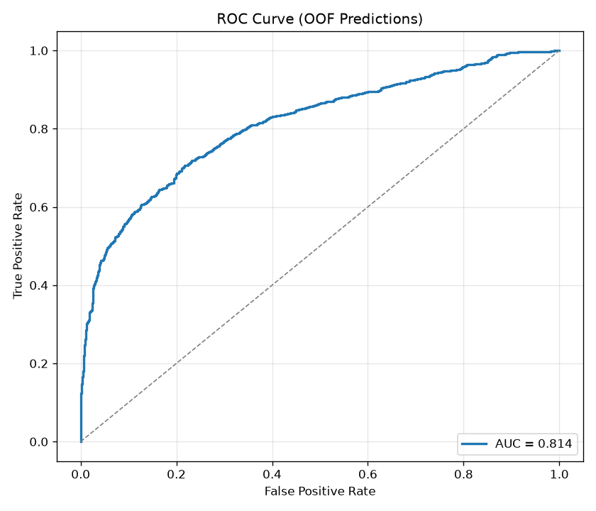|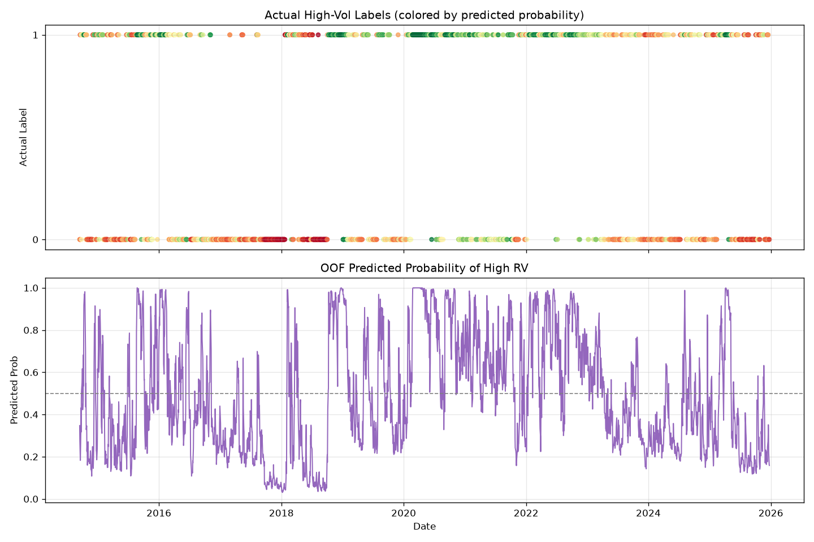 |
||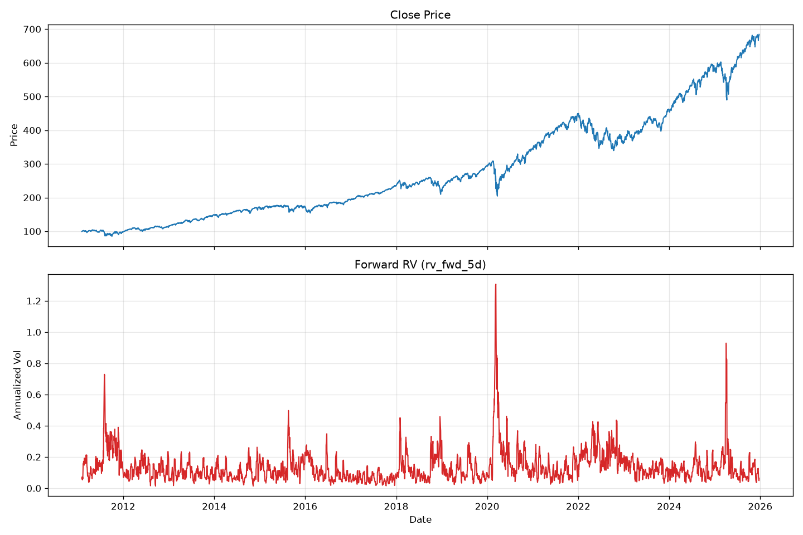 |

### Evaluate a Saved Run

```bash
uv run python eval.py \
  --run-dir cache/runs/<your-run-dir> \
  --regime-method kmeans \
  --n-regimes 2
  --shap-max-samples -1
```

```
GARCH-Calibrated Baseline
  - Calibrates a single GARCH volatility forecast (garch_vol_1d) into binary probabilities
    via out-of-fold logistic regression with StandardScaler + LogisticRegression(max_iter=1000).
  - TimeSeriesSplitWithPurge CV is used for OOF predictions; min 50 training samples and
    at least 2 label classes required per fold. Fallback: mean(y_train) when conditions unmet.

DM (Brier) — garch:
  DM stat           : 8.7773
  Mean loss diff    : 0.0765
  Variance estimator: newey_west
  HAC lag           : 4
  p-value (one-sided): 0.0000

DM (Log-Loss) — garch:
  DM stat           : 8.8492
  Mean loss diff    : 0.1858
  Variance estimator: newey_west
  HAC lag           : 4
  p-value (one-sided): 0.0000
RV Persistence Baseline
  - Uses today's realized volatility histogram high/low state (rv_hist_5d) vs. an
    expanding median threshold computed from past observations (no look-ahead).
  - Predicts p_t = 1 when today's rv_hist_5d[t] >= expanding median of rv_hist_5d[:t],
    else p_t = 0. First sample falls back to unconditional mean(y).

DM (Brier) — rv_persist:
  DM stat           : -18.3730
  Mean loss diff    : -0.1390
  Variance estimator: newey_west
  HAC lag           : 4
  p-value (one-sided): 1.0000

DM (Log-Loss) — rv_persist:
  DM stat           : 4.3601
  Mean loss diff    : 0.6795
  Variance estimator: newey_west
  HAC lag           : 4
  p-value (one-sided): 0.0000
Prior Probability Baseline
  - Prediction: expanding historical mean of labels up to time t (no look-ahead).
  - For observation t, p_t = mean(y[:t]). The first sample uses mean(y) as fallback.

DM (Brier) — prior:
  DM stat           : 11.1104
  Mean loss diff    : 0.0769
  Variance estimator: newey_west
  HAC lag           : 4
  p-value (one-sided): 0.0000

DM (Log-Loss) — prior:
  DM stat           : 9.3968
  Mean loss diff    : 0.1891
  Variance estimator: newey_west
  HAC lag           : 4
  p-value (one-sided): 0.0000

Conclusion: Model significantly outperforms the first baseline on Brier score (DM test, p < 0.05); improvement is unlikely due to chance alone.

=== Regime-based Confusion Matrices — KMeans (n=2) ===
Macro indicator: vix_ma30_from_yfinance
Method         : KMeans | rule=cluster_mean_descending
Cluster means  : Cluster_1=26.8882, Cluster_2=15.5280

Overall: n=2772
  confusion_matrix [[tn, fp], [fn, tp]] = [[1089, 264], [469, 950]]

Cluster_1: n=665, mean=26.8882
  confusion_matrix [[tn, fp], [fn, tp]] = [[30, 67], [61, 507]]

Cluster_2: n=2107, mean=15.5280
  confusion_matrix [[tn, fp], [fn, tp]] = [[1059, 197], [408, 443]]
```
| Confusion Matrix| Macro Regime Clusters|
|--|--|
|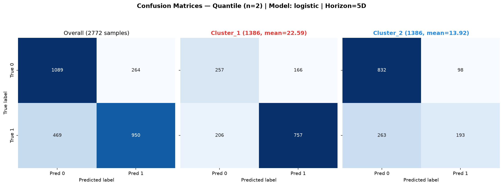|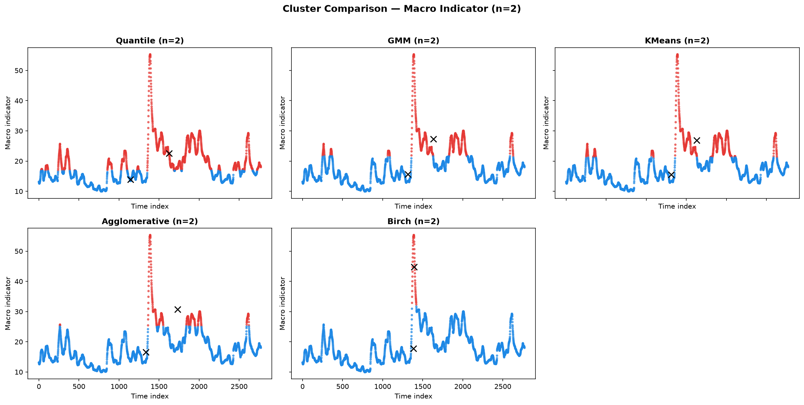 |
|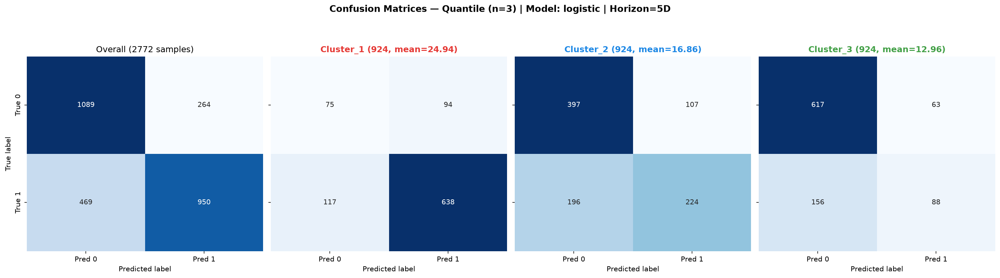|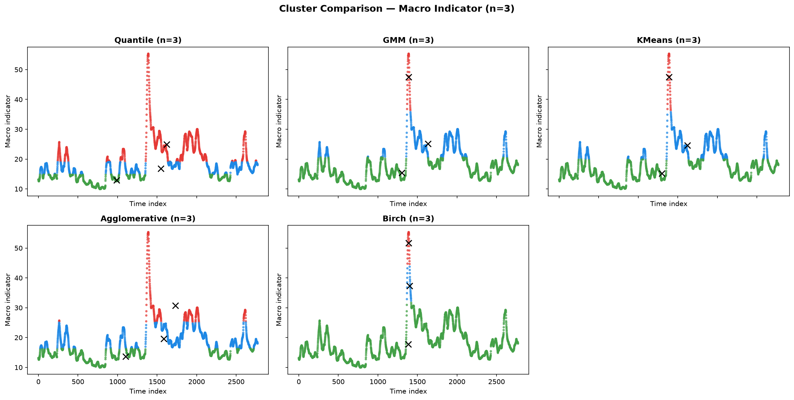 |


### Train and Evaluate in One Command

```bash
uv run python main.py
```

The configuration for `main.py` is controlled by the `CONFIG` dictionary at the top of the file.

---

## 6. Training Pipeline

The training workflow follows the steps below:

```text
Load data
   ↓
Build features
   ↓
Construct target and binary label
   ↓
Optional feature selection
   ↓
Create time-series CV splits
   ↓
Tune models with Optuna
   ↓
Select best model
   ↓
Fit final model
   ↓
Save artifacts and plots
```


---

## 7. Data Loading

The pipeline first attempts to download real OHLCV data using `yfinance`.

Typical inputs include:

- `Open`
- `High`
- `Low`
- `Close`
- `Volume`

The data layer also attempts to attach additional market context columns:

- `vix`: VIX index
- `vix3m`: 3-month VIX
- `vvix`: volatility of volatility index
- `skew`: SKEW index
- `tnx`: 10-year Treasury yield
- `dxy`: US dollar index
- `gold`: gold futures

If one of these external tickers is unavailable, it is skipped without interrupting training.

If the main ticker data cannot be loaded, the system can automatically use synthetic data instead.


---

## 8. Feature Engineering

Feature engineering is implemented as a modular step system. Each feature step adds one or more columns to the input DataFrame while preserving time-series alignment.

Most predictive features are shifted where necessary so that only information available before the prediction time is used.


## 9. Core Feature Groups
The current default `DEFAULT_FEATURE_STEPS` in `features/core.py` contains the following 49 features, in execution order:

`ret_1d`, `hl_range`, `rv_hist_5d`, `rv_hist_20d`, `gk_rv`, `rs_rv`, `yz_rv`, `volume_zscore`, `parkinson_rv`, `ewma_rv`, `downside_rv`, `vol_of_vol`, `rv_accel`, `ret_skew_20d`, `ret_kurt_20d`, `max_drawdown_20d`, `ret_autocorr_1_20d`, `abs_ret_lag1`, `rv_ratio_5_20`, `vix_level`, `vix_change_1d`, `vix_term_structure`, `vix_rv_spread`, `vvix_level`, `skew_index_level`, `yield_change_1d`, `dxy_change_1d`, `gold_ret_1d`, `day_of_week`, `is_month_end`, `is_quarter_end`, `dist_from_ma50`, `bb_width`, `overnight_ret`, `intraday_ret`, `overnight_vol_5d`, `garch_vol_1d`, `gjr_garch_vol_1d`, `egarch_vol_1d`, `garch_vol_ratio_5_20`, `garch_rv_spread`, `har_rv_forecast_1d`, `kalman_price_medium`, `kalman_ret_1d_medium`, `kalman_trend_medium`, `kalman_resid_medium`, `kalman_resid_zscore_medium`, `kalman_state_var_medium`, `close_to_kalman_medium`

Among them:

- Features that rely only on the target asset’s own OHLCV data can be built directly from the main market data, such as `gk_rv`, `yz_rv`, `downside_rv`, GARCH, HAR-RV, and Kalman features.
- Macro / cross-asset features depend on market context columns automatically appended by `load_data.py`: `vix`, `vix3m`, `vvix`, `skew`, `tnx`, `dxy`, `gold`.
- The data layer will attempt to fetch `^VIX`, `^VIX3M`, `^VVIX`, `^SKEW`, `^TNX`, `DX-Y.NYB`, `GC=F`. If a ticker is missing, it will be skipped automatically without blocking training.
- GARCH / HAR-RV / Kalman features depend on `arch` / `scikit-learn` / `pykalman`, and are all aligned with `shift(1)` so they use only information available before the market open.
- Kalman filtering is performed on `log(Close)` using a local linear trend model ( `process_var=1e-5`, `obs_var=1e-3`), and then mapped back to price semantics when needed; non-positive prices are treated as missing.
- HAR-RV uses daily Garman-Klass annualized volatility to construct `(RV^{(d/w/m)})` (1/5/22), then applies `StandardScaler` + Ridge ( `alpha=1.0`, `fit_window=750`, `min_obs=252`) within a rolling window for one-step forecasting. Negative values are clipped to 0 before `shift(1)`.
- DM evaluation, in addition to prior / RV persistence baselines, also compares the `garch_vol_1d` Logistic calibration baseline ( `garch_vol_1d_logistic_calibration`).


<table border="1" cellspacing="0" cellpadding="6">
  <thead>
    <tr>
      <th>Category</th>
      <th>Subcategory</th>
      <th>Purpose</th>
    </tr>
  </thead>
  <tbody>
    <tr>
      <td rowspan="3">Price and Volatility Fundamentals</td>
      <td>Return and Price Features</td>
      <td>
        Capture short-term return direction<br>
        Measure daily trading range<br>
        Detect price deviation from moving averages<br>
        Capture volatility expansion through Bollinger Band width
      </td>
    </tr>
    <tr>
      <td>Historical Realized Volatility Features</td>
      <td>
        Capture short-term and medium-term realized volatility<br>
        Identify whether recent volatility is elevated relative to its medium-term level<br>
        Provide baseline volatility state information
      </td>
    </tr>
    <tr>
      <td>OHLC-Based Volatility Estimators</td>
      <td>
        Use more information than close-to-close returns<br>
        Improve volatility estimation efficiency<br>
        Capture intraday and overnight volatility components
      </td>
    </tr>
    <tr>
      <td rowspan="3">Risk and State Dynamics</td>
      <td>Downside Risk and Tail Features</td>
      <td>
        Detect downside volatility<br>
        Capture left-tail risk<br>
        Identify heavy-tailed return behavior<br>
        Measure recent drawdown pressure
      </td>
    </tr>
    <tr>
      <td>Volatility Dynamics Features</td>
      <td>
        Detect volatility regime shifts<br>
        Capture volatility acceleration<br>
        Model short-term volatility clustering
      </td>
    </tr>
    <tr>
      <td>Macro and Cross-Asset Features</td>
      <td>
        Capture implied volatility level<br>
        Detect market stress<br>
        Measure term-structure inversion<br>
        Include macro risk sentiment and safe-haven signals
      </td>
    </tr>
    <tr>
      <td rowspan="4">Temporal Structure and Model Features</td>
      <td>Calendar Features</td>
      <td>
        Capture weekly seasonality<br>
        Identify month-end and quarter-end effects<br>
        Improve model awareness of calendar-driven flows
      </td>
    </tr>
    <tr>
      <td>GARCH-Based Features</td>
      <td>
        Capture volatility clustering<br>
        Model asymmetric volatility responses<br>
        Provide model-based volatility expectations
      </td>
    </tr>
    <tr>
      <td>HAR-RV Feature</td>
      <td>
        Capture heterogeneous volatility persistence<br>
        Combine short-, medium-, and long-horizon volatility information<br>
        Provide a strong volatility forecasting baseline feature
      </td>
    </tr>
    <tr>
      <td>Kalman Filter Features</td>
      <td>
        Separate noisy price movement from latent trend<br>
        Detect deviations from filtered price<br>
        Capture trend strength and model uncertainty
      </td>
    </tr>
  </tbody>
</table>


### 9.1 Return and Price Features

These features describe recent price movement and trend deviation.

Examples:

```text
ret_1d = Close.pct_change()

hl_range = (High - Low) / Close

dist_from_ma50 = (Close - MA50) / MA50

bb_width = 4 * rolling_std(Close, 20) / rolling_mean(Close, 20)
```

Purpose:

- Capture short-term return direction
- Measure daily trading range
- Detect price deviation from moving averages
- Capture volatility expansion through Bollinger Band width


---

### 9.2 Historical Realized Volatility Features

Historical realized volatility is computed from daily returns.

Examples:

```text
rv_hist_5d = rolling_std(ret_1d, 5) * sqrt(252)

rv_hist_20d = rolling_std(ret_1d, 20) * sqrt(252)

rv_ratio_5_20 = rv_hist_5d / rv_hist_20d
```

Purpose:

- Capture short-term and medium-term realized volatility
- Identify whether recent volatility is elevated relative to its medium-term level
- Provide baseline volatility state information

---

### 9.3 OHLC-Based Volatility Estimators

The pipeline includes several classical OHLC volatility estimators.

Examples:

```text
parkinson_rv uses log(High / Low)

gk_rv uses log(High / Low) and log(Close / Open)

rs_rv uses log(High / Open), log(Low / Open), and log(Close / Open)

yz_rv combines overnight, open-to-close, and Rogers-Satchell components
```

Purpose:

- Use more information than close-to-close returns
- Improve volatility estimation efficiency
- Capture intraday and overnight volatility components


---

### 9.4 Downside Risk and Tail Features

These features focus on asymmetric risk and extreme movements.

Examples:

```text
downside_rv = sqrt(mean(negative_ret_1d^2)) * sqrt(252)

ret_skew_20d = rolling_skew(ret_1d, 20)

ret_kurt_20d = rolling_kurt(ret_1d, 20)

max_drawdown_20d = rolling_min(Close / rolling_max(Close) - 1)
```

Purpose:

- Detect downside volatility
- Capture left-tail risk
- Identify heavy-tailed return behavior
- Measure recent drawdown pressure

---

### 9.5 Volatility Dynamics Features

These features describe changes in volatility itself.

Examples:

```text
vol_of_vol = rolling_std(rv_hist_5d, 20)

rv_accel = rv_hist_5d - rv_hist_5d.shift(5)

abs_ret_lag1 = abs(ret_1d).shift(1)
```

Purpose:

- Detect volatility regime shifts
- Capture volatility acceleration
- Model short-term volatility clustering

---

### 9.6 Macro and Cross-Asset Features

The pipeline can attach external market indicators.

Examples:

```text
vix_level = VIX close

vix_change_1d = vix.diff().shift(1)

vix_term_structure = vix3m - vix

vix_rv_spread = vix / 100 - rv_hist_20d

yield_change_1d = tnx.diff().shift(1)

dxy_change_1d = dxy.pct_change().shift(1)

gold_ret_1d = gold.pct_change().shift(1)
```

Purpose:

- Capture implied volatility level
- Detect market stress
- Measure term-structure inversion
- Include macro risk sentiment and safe-haven signals


---

### 9.7 Calendar Features

Calendar variables capture recurring market effects.

Examples:

```text
day_of_week = trading_date.dayofweek

is_month_end = 1 if date is month-end else 0

is_quarter_end = 1 if date is quarter-end else 0
```

Purpose:

- Capture weekly seasonality
- Identify month-end and quarter-end effects
- Improve model awareness of calendar-driven flows

---

### 9.8 GARCH-Based Features

The pipeline includes GARCH-family one-step volatility forecasts.

Examples:

```text
garch_vol_1d

gjr_garch_vol_1d

egarch_vol_1d
```

General calculation:

```text
1. Compute log return:
   r_t = log(Close_t) - log(Close_{t-1})

2. Fit a rolling GARCH-family model

3. Forecast next-day volatility

4. Annualize the forecast

5. Shift by one day to avoid look-ahead leakage
```

Derived features:

```text
garch_vol_ratio_5_20 = garch_vol_1d / rv_hist_20d

garch_rv_spread = garch_vol_1d - rv_hist_20d
```

Purpose:

- Capture volatility clustering
- Model asymmetric volatility responses
- Provide model-based volatility expectations


---

### 9.9 HAR-RV Feature

The HAR-RV feature models volatility using daily, weekly, and monthly realized volatility components.

Simplified calculation:

```text
1. Estimate daily OHLC-based realized volatility

2. Build three components:
   RV_daily
   RV_weekly
   RV_monthly

3. Fit a rolling Ridge regression model

4. Forecast one-step-ahead realized volatility

5. Clip negative predictions to zero

6. Shift by one day to avoid leakage
```

Feature:

```text
har_rv_forecast_1d
```

Purpose:

- Capture heterogeneous volatility persistence
- Combine short-, medium-, and long-horizon volatility information
- Provide a strong volatility forecasting baseline feature

---

### 9.10 Kalman Filter Features

Kalman features are computed from a local-linear-trend model on log prices.

Simplified calculation:

```text
1. Transform price:
   z_t = log(Close_t)

2. Apply Kalman filtering to estimate smooth latent price state

3. Extract filtered price, trend, residual, and state uncertainty

4. Shift features by one day
```

Examples:

```text
kalman_price_medium

kalman_ret_1d_medium

kalman_trend_medium

kalman_resid_medium

kalman_resid_zscore_medium

kalman_state_var_medium

close_to_kalman_medium
```

Purpose:

- Separate noisy price movement from latent trend
- Detect deviations from filtered price
- Capture trend strength and model uncertainty


---

## 10. Target and Label Construction

The prediction target is forward realized volatility over a future horizon.

The label is binary and compares the forward realized volatility to a historical threshold.

### 10.1 Forward Realized Volatility

Given daily returns:

```text
ret_1d_t = Close_t / Close_{t-1} - 1
```

Forward realized volatility over horizon `H` is calculated as:

```text
rv_fwd_Hd,t = sqrt(sum(ret_1d_{t+1}^2 + ... + ret_1d_{t+H}^2)) * sqrt(252 / H)
```

In the codebase, this is handled by:

```python
compute_forward_rv(data["ret_1d"], horizon=horizon)
```

---

### 10.2 Binary Label

The binary label is created by comparing forward realized volatility against a dynamic threshold.

Let (r_t) denote the daily return. The forward realized volatility target over an (h)-day horizon is defined as:

$$
RV_t^{(h)}=\sqrt{\sum_{i=1}^{h} r_{t+i}^{2}}
$$

A binary volatility regime label is generated by comparing ($RV_t^{(h)}$) with a dynamic median threshold ($\theta_t$) (expanding or rolling window):

$$
y_t=\mathbb{I}(RV_t^{(h)}>\theta_t)

$$
where ($y_t=1$) indicates a high future volatility regime and ($y_t=0$) otherwise.


The resulting label is:

```text
y_t = 1 if rv_fwd_Hd,t > threshold_t
y_t = 0 otherwise
```

Supported threshold methods:

| Method | Description |
|---|---|
| `expanding` | Compares forward RV to the expanding historical median |
| `rolling` | Compares forward RV to a rolling median window |
| `median` | Uses median-based thresholding in the pipeline interface |

This formulation makes the prediction problem adaptive to changing volatility environments.


---

## 11. Feature Selection

The pipeline supports optional feature selection.

Available methods include:

```text
tree_topk
lasso
ttest
none
```

Example CLI usage:

```bash
uv run python train.py \
  --feature-selection lasso \
  --top-k-features 12
```

Feature selection helps:

- Reduce dimensionality
- Improve model stability
- Improve interpretability
- Lower overfitting risk

| Method |
|:-:|
| 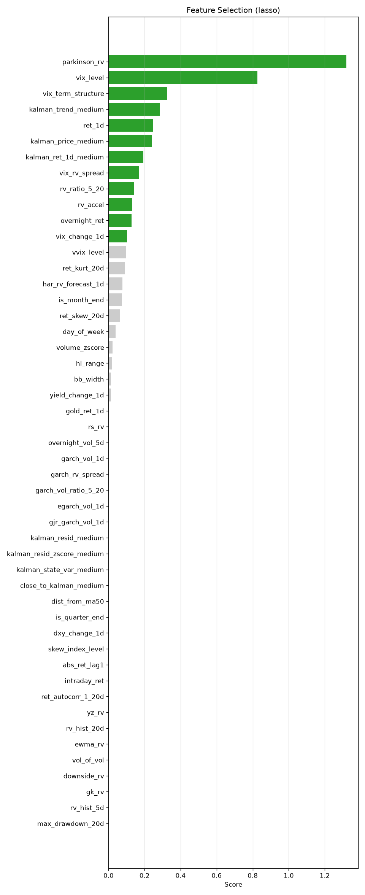| 
|  |

---

## 12. Model Training

The current model registry supports:

```text
logistic
xgb
lgbm
```

Each model is tuned with Optuna using time-series cross-validation.

The default optimization objective is AUC.

### Optuna Pruning & Trial-Level Early Stopping

The pipeline uses **Optuna's HyperbandPruner** combined with a custom **patience pruner** (`_PatiencePruner`). Together they provide two layers of early termination to save compute:

1. **Per-fold pruning (HyperbandPruner)** — after each fold completes inside a trial, the per-fold AUC is reported via `trial.report()` and checked against `should_prune()`. Trials whose intermediate scores fall below the resource-adapted threshold are aborted immediately. This enables successive halving across the CV folds within a single trial.

2. **Per-trial patience stopping (`--early-stop N`)** — a custom `_PatiencePruner` monitors the sequence of intermediate values across all completed folds. If the best score seen so far has not been improved upon for `N` consecutive folds (default 5), the trial is pruned. This prevents wasting computation on trials that consistently underperform relative to the running optimum.

Both mechanisms are controlled through the CLI parameter `--early-stop N`:

| Parameter | Description |
|---|---|
| `--early-stop` | Number of consecutive folds without improvement before terminating a trial (default: 5). Set to 0 or 1 for aggressive pruning; higher values allow more exploration at the cost of runtime. |

### Example

```bash
uv run python train.py \
  --symbol SPY \
  --start 2018-01-01 \
  --end 2024-12-31 \
  --models logistic xgb lgbm \
  --n-trials 30 \
  --early-stop 5
```

During training, the pipeline:

1. Builds cross-validation splits
2. Runs Optuna trials for each model with pruning
3. Evaluates each trial using out-of-fold validation
4. Selects the best model
5. Fits the best model on the available training data
6. Saves model artifacts and reports

| Optuna Trials |
|--|
|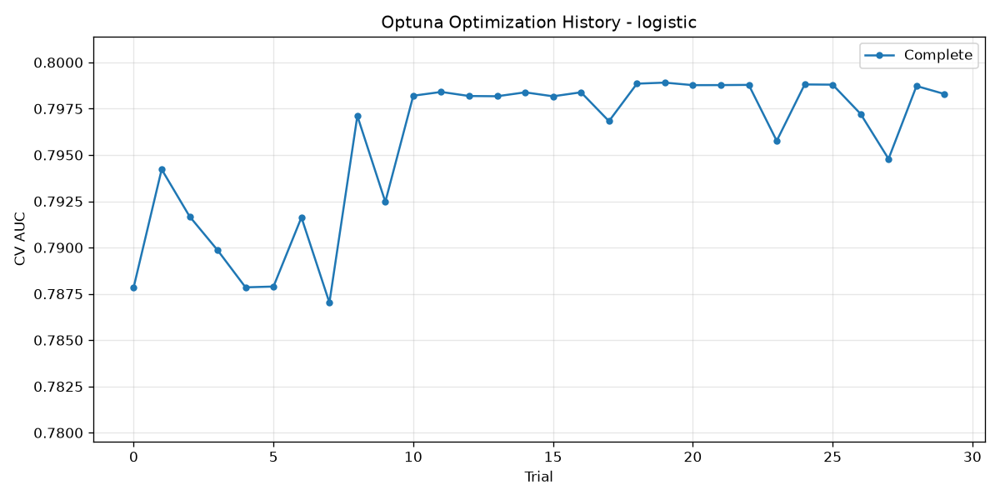| 
|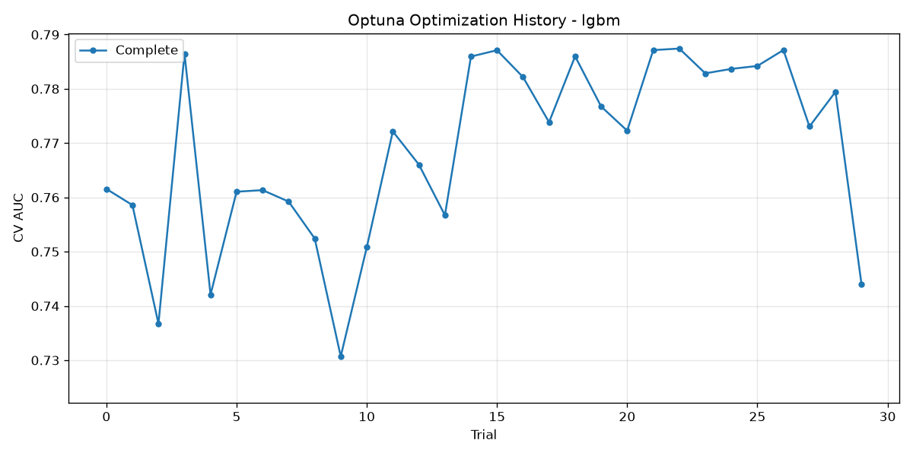| 
|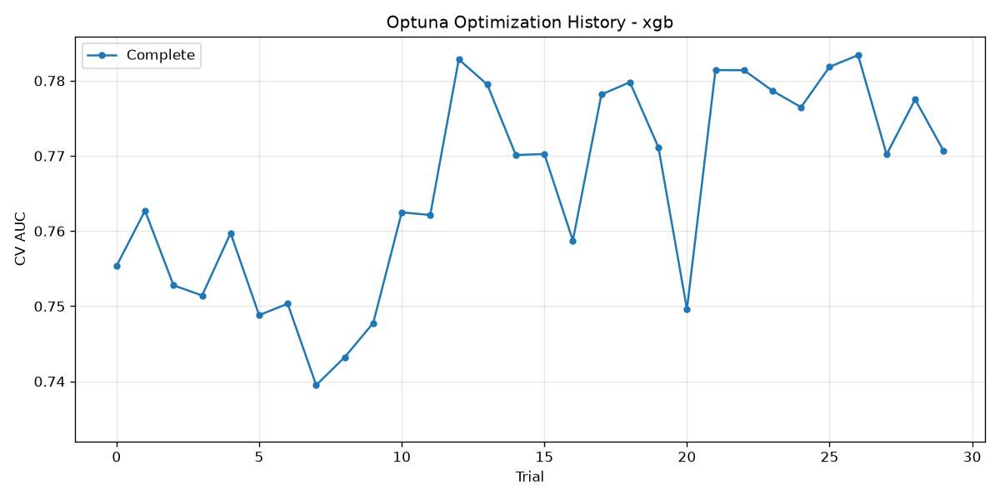| 


---

## 13. Time-Series Cross-Validation

The pipeline uses time-series-aware cross-validation with a purge gap.

Important parameters:

| Parameter | Description |
|---|---|
| `n_splits` | Number of cross-validation folds |
| `train_window` | Length of each training window |
| `test_size` | Length of each validation window |
| `gap_size` | Gap between training and validation windows |

Example:

```bash
uv run python train.py \
  --n-splits 11 \
  --train-window 252 \
  --test-size 21 \
  --gap-size 5
```

The gap helps reduce look-ahead leakage, especially because the target uses forward realized volatility.

> **Note:** When `n_splits > 10`, the pipeline emits a `UserWarning` indicating that training time will increase significantly. Consider reducing to 5–10 splits unless you have sufficient compute budget.


---

## 14. Saved Artifacts

Each run creates a self-contained experiment folder under:

```text
cache/runs/
```

Example structure:

```text
cache/
  runs/
    lgbm-tree_topk-20260623_080630/
      config/
        pipeline.json
        cv.json
        best_params.json
        model_comparison.json
        feature_selection.json
      data/
        raw.csv
        X.csv
        y.csv
        meta.csv
        oof_predictions.csv
      model/
        best_model.joblib
      plots/
        *.png
```

This makes every run reproducible and easy to evaluate later.

---

## 15. Evaluation Pipeline

The evaluation module provides a full post-training diagnostic workflow.

It includes:

- Out-of-fold prediction metrics
- Baseline comparisons
- Diebold-Mariano tests
- Regime-based confusion matrices
- VIX-based macro regime clustering
- Evaluation plots
- LLM briefing

Run evaluation with:

```bash
uv run python eval.py --run-dir cache/runs/<your-run-dir>
```


---

## 16. Probabilistic Metrics

The model outputs prediction probabilities.

The evaluation module reports probabilistic metrics such as:

```text
Brier Score
Log Loss
```

These metrics are important because the task is not only about directional classification, but also about probability calibration.

Lower values indicate better probabilistic forecasts.


---

## 17. Baseline Comparison

The evaluation module compares the trained model against multiple baselines.

Available baselines include:

```text
prior
rv_persist
garch
```

Example:

```bash
uv run python eval.py \
  --run-dir cache/runs/<your-run-dir> \
  --baselines prior,garch
```

Baseline meanings:

| Baseline | Description |
|---|---|
| `prior` | Historical class probability baseline |
| `rv_persist` | Realized-volatility persistence baseline |
| `garch` | Logistic calibration based on GARCH volatility forecast |

The pipeline also supports Diebold-Mariano tests to compare per-observation forecast losses.


---

## 18. Regime-Based Evaluation

Market behavior changes across volatility regimes. To evaluate robustness, the pipeline groups predictions by macro volatility regimes.

The default macro indicator is:

```text
VIX 30-day moving average
```

If VIX data is unavailable, the system falls back to a rolling volatility estimate based on the OOF price series.

Supported regime clustering methods:

```text
quantile
gmm
kmeans
agglomerative
birch
all
```

Example:

```bash
uv run python eval.py \
  --run-dir cache/runs/<your-run-dir> \
  --regime-method kmeans \
  --n-regimes 2
```

The clusters are relabeled by macro indicator level:

```text
Cluster_1 = highest macro volatility regime
Cluster_2 = lower macro volatility regime
...
```

This allows the model to be evaluated separately in high-volatility and low-volatility environments.

| N = 2 | N = 3|
|--|--|
|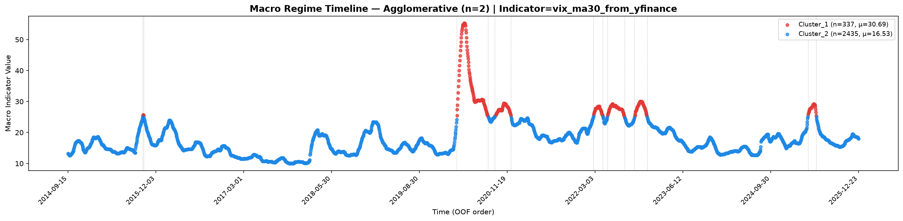| 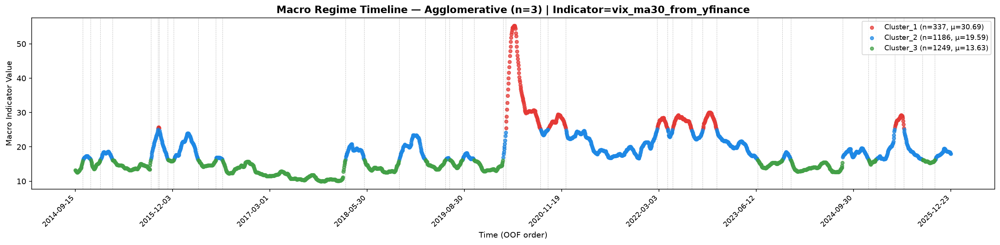|
|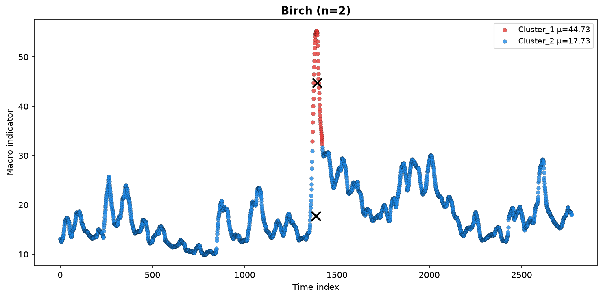| 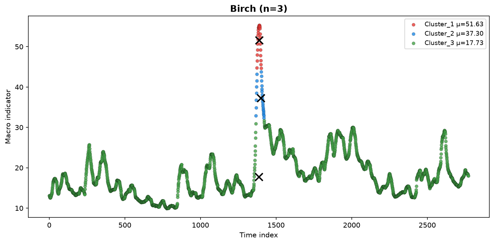|
|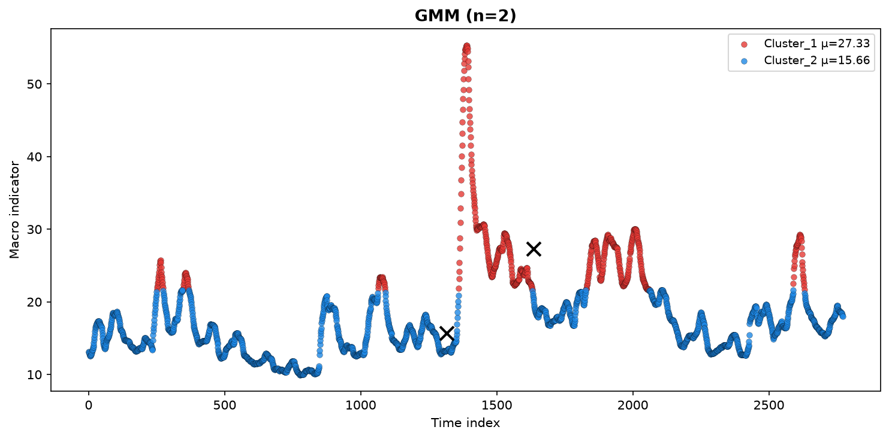| 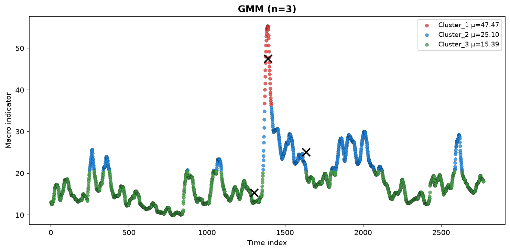|
|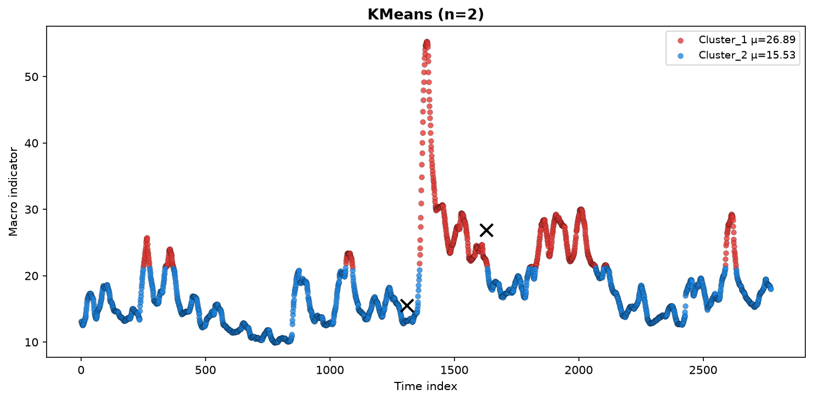| 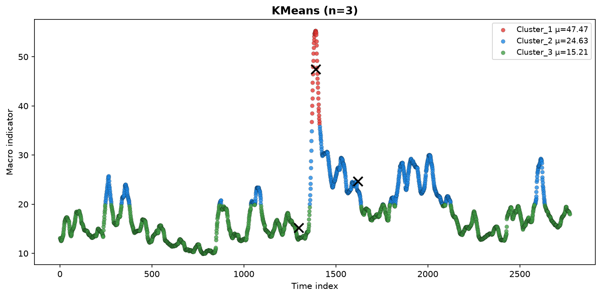|
|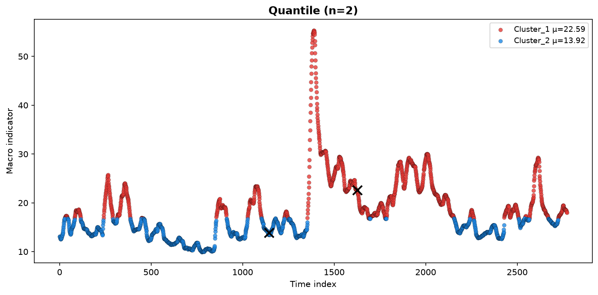| 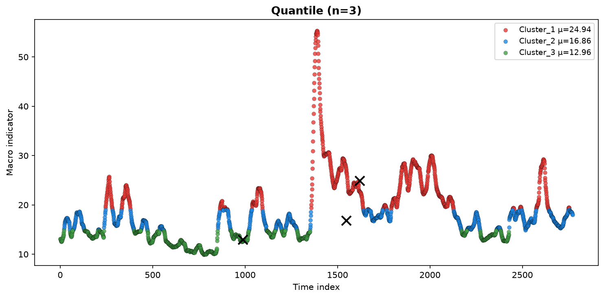|


---

## 19. Evaluation Plots

The evaluation module automatically saves plots to:

```text
{run_dir}/plots/
```

Typical output files include:

```text
confusion_matrices_kmeans_n2.png
macro_regime_timeline_kmeans_n2.png
cluster_scatter_kmeans_n2.png
cluster_comparison_n2.png
```

These visualizations help show that the pipeline is not only numerically robust, but also easy to diagnose visually.

Recommended figures to include in reports:

- Overall confusion matrix
- Regime-specific confusion matrices
- Macro regime timeline
- Cluster scatter plot
- Model-vs-baseline comparison
- OOF prediction timeline
- Feature importance plot

| Confusion Matrix - KMeans Cluster |
|--|
|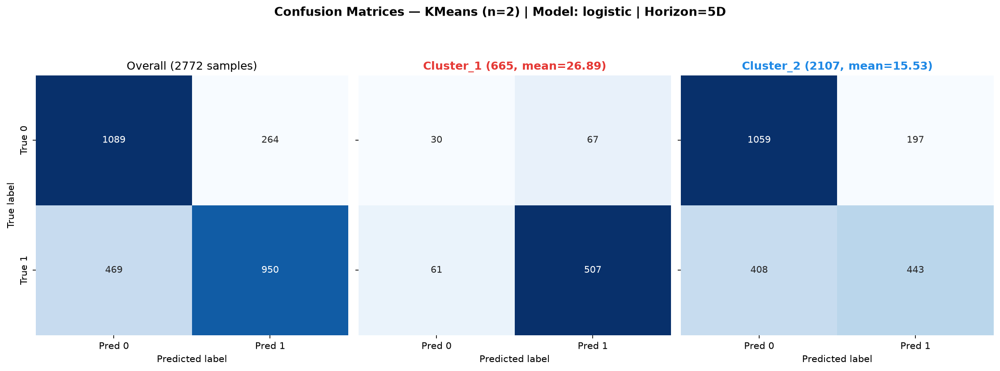| 
|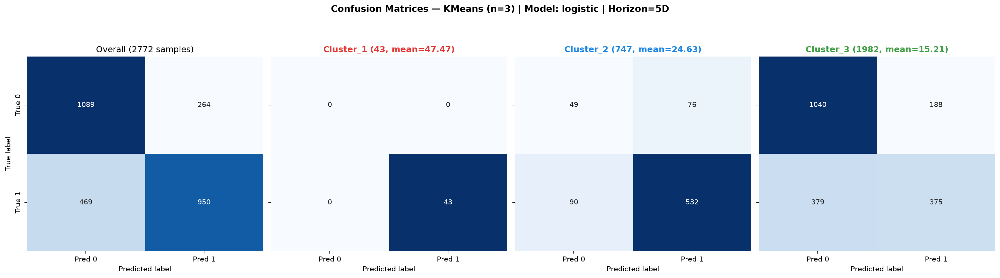| 

---

## 20. LLM-Assisted Evaluation Briefing

The evaluation workflow includes an optional LLM briefing module.

It summarizes:

- Model performance
- Key SHAP-style feature signals
- Regime-specific weaknesses
- Baseline comparison
- Possible risk warnings

If no LLM API key is available, the system falls back to a rule-based summary.

This makes the evaluation output more interpretable and suitable for presentation.

```json
// LLM SHAP summary
{
    "status": "approved",
    "final_brief": "`[DR]` In this model, downside_rv has a SHAP value of 0.4004274642420753, vol_of_vol has a value of 0.26804987908225236, and ewma_rv has a value of -0.20919584346879797.`[FI]` These metrics indicate a contracting market regime where downside risk and volatility of volatility are the primary forces driving the consolidation.",
    "issues": [],
}

// Fallback SHAP Summary
{
    "final_brief": "[DR] kalman_price_medium has SHAP contribution 0.9118 for predicted class contracting. [FI] The upward pressure from kalman_price_medium appears to be the dominant driver in the current volatility regime transition."
}
```
---

## 26. Why This Pipeline Is Robust

This pipeline is robust because it combines:

- Safe data fallback logic
- Modular feature engineering
- Leakage-aware time-series validation
- Multiple model families
- Optuna-based hyperparameter tuning
- Feature selection options
- Reproducible run artifacts
- Out-of-fold evaluation
- Baseline comparison
- Regime-specific diagnostics
- Clear visualization outputs
- Optional LLM-assisted interpretation

Together, these components provide a complete experimental framework for realized volatility regime prediction.


---

## 28. Summary

This project provides a complete, reproducible, and visually interpretable machine learning pipeline for realized volatility classification.

It covers the full workflow from data loading and feature construction to model training, evaluation, regime analysis, and reporting. The modular design makes it easy to extend, while the saved artifacts and visual outputs make the results easy to audit, reproduce, and present.

---

## 29. Streamlit RV Prediction Lab

The Streamlit application in `project/src/streamlit_app/` provides an interactive
five-station workbench over the training pipeline. Its entry point is
`project/app.py`.

### 29.1 Run the Application

All commands in this section assume that the current directory is `project/`:

```bash
cd project
uv sync
cp .env.example .env
uv run streamlit run app.py
```

Open the URL printed by Streamlit, normally `http://localhost:8501`.

The supported Python range is `>=3.11,<3.13`. Dependencies are declared in
`pyproject.toml` and locked in `uv.lock`.

### 29.2 Environment Configuration

Configure the application through `project/.env`:

```dotenv
CACHE_PATH=
LLM_API_KEY=
LLM_MODEL=gemini-3.5-flash
CLASS_INVITE_CODE=
ALLOW_ANON=
```

- `CACHE_PATH`: optional cache location used by the project. Leave it empty to
  use the project defaults.
- `LLM_API_KEY`: Google Gemini API key for the AI tutor and LLM-assisted
  reports.
- `LLM_MODEL`: Gemini model name. The example configuration uses
  `gemini-3.5-flash`.
- `CLASS_INVITE_CODE`: invite code required for new user registration when
  anonymous access is disabled. Registration is unavailable if this value is
  empty.
- `ALLOW_ANON`: set to `1`, `true`, or `yes` for a local anonymous user. Set
  it to `0` to require registration and login. The application defaults to
  anonymous access when this variable is omitted.

For the AI tutor, an API key supplied in the current session takes precedence
over a key saved for the user, which in turn takes precedence over
`LLM_API_KEY` from the environment.

### 29.3 Application Workflow

The sidebar controls the active workspace, global symbol and horizon, station
navigation, and pipeline status. The stations must generally be completed in
order because changing an upstream setting invalidates dependent downstream
results.

1. **Station 1: ETL**
   - Loads a precomputed SPY or QQQ teaching pack for a 5-day or 10-day horizon.
   - Allows a date slice to be selected before loading.
   - Can alternatively download live data through `yfinance` or use synthetic
     fallback data.
   - Live-data workspaces cannot use Station 5.
2. **Station 2: Feature Engineering**
   - Selects registered features.
   - Builds the feature matrix, metadata, forward-RV target, and either
     `expanding` or rolling `median` labels.
3. **Station 3: Model Design**
   - Creates a time-ordered train/test split.
   - Configures purged time-series cross-validation, including split count,
     training window, test size, and gap.
   - Tunes Logistic Regression, XGBoost, and LightGBM with Optuna.
4. **Station 4: Implementation**
   - Compares trained models and displays out-of-fold and holdout evaluation.
   - Provides ROC, feature-importance, SHAP, and optional LLM-assisted analysis.
   - Exports OOF predictions and feature importance as CSV files.
5. **Station 5: Comparison**
   - Browses and filters the offline experiment grid.
   - Compares experiments with bubble and radar views.
   - Opens complete run artifacts for detailed inspection.
   - Can run and persist custom experiments under
     `cache/precomputed/runs/custom_*`.

The presentation of Station 5 is configured by
`configs/comparison_view.yaml`. Its offline experiments, date ranges,
cross-validation profiles, models, and tuning settings are defined in
`configs/grid_recipe.yaml`.

### 29.4 Teaching Packs and Precomputed Artifacts

The precomputed data contract is:

```text
project/cache/precomputed/
├── SPY_5d.parquet
├── SPY_10d.parquet
├── QQQ_5d.parquet
├── QQQ_10d.parquet
├── manifest.json
├── grid_results.parquet
└── runs/
    └── <experiment_id>/
```

The four teaching packs contain the full enriched timeline and both supported
label variants. `manifest.json` records their symbols, horizons, dimensions,
date ranges, and paths. `grid_results.parquet` is the Station 5 experiment
index.

A run is considered complete for detailed loading when it contains at least:

```text
data/y.csv
data/oof_predictions.csv
config/pipeline.json
```

Generate teaching packs before generating the experiment grid, because the
grid reads the teaching-pack Parquet files:

```text
precompute_data.py
        ↓
precompute_grid.py
        ↓
Streamlit Station 5
```

### 29.5 Authentication and Workspaces

The application stores users, workspaces, and experiments in
`project/data/workspaces.db`.

- With `ALLOW_ANON=1`, the application uses a local anonymous account.
- With `ALLOW_ANON=0`, users must register with `CLASS_INVITE_CODE` and log in.
- A workspace must be created or selected before using the stations.
- Workspace checkpoints preserve the applied configuration and support
  restoration after a rerun.
- The sidebar can save, rename, export, and import workspaces.
- Workspace exports are ZIP files containing `workspace.json` and, when
  available, fitted model and custom-run artifacts.
- An imported ZIP can create a new workspace or overwrite the current one.
- Plain JSON workspace imports are not supported.

The SQLite database is application state, not a substitute for the
`cache/precomputed/` teaching packs and experiment artifacts.

### 29.6 AI Tutor

The right-hand AI rail is a LangGraph ReAct tutor backed by Google Gemini. It
can inspect the current station, available features, model registry, and
workspace state. Actions that would alter settings are returned as proposals;
the user must explicitly apply them in the interface. This prevents an AI
response from silently changing the active experiment.

### 29.7 Docker

Build the image from `project/`:

```bash
cd project
docker build -t rv-lab .
docker run --rm -p 8080:8080 \
  -e PORT=8080 \
  -e CLASS_INVITE_CODE=replace-me \
  -e LLM_API_KEY=replace-me \
  rv-lab
```

The Docker image uses Python 3.12, installs the locked production
dependencies, includes the precomputed artifacts present at build time, and
sets `ALLOW_ANON=0`. The container therefore requires a class invite code for
new registrations unless that environment setting is overridden.

---

## 30. Utility Scripts

`project/scripts/` contains three operational utilities. Run them from
`project/` with `uv`. These commands write or replace data, model artifacts, or
workspace state; review the paths and options before running them.

### 30.1 `precompute_data.py`

Builds wide teaching-pack Parquet files and `manifest.json`. It downloads or
generates raw data, applies every registered feature without feature
selection, computes the forward realized-volatility target, and adds both
`y_expanding` and `y_median` labels.

Default command:

```bash
uv run python scripts/precompute_data.py
```

Default behavior:

- Symbols: `SPY QQQ`
- Horizons: `5 10`
- Start: `2005-01-01`
- End: `2026-03-01`
- Output: `cache/precomputed/<SYMBOL>_<HORIZON>d.parquet`
- Manifest: `cache/precomputed/manifest.json`

Options:

```text
--start DATE             Inclusive data start date
--end DATE               Data end date passed to the loader
--symbols SYMBOL [...]   One or more ticker symbols
--horizons DAYS [...]    One or more integer forecast horizons
--synthetic              Force synthetic data instead of market downloads
```

Examples:

```bash
# Build only the standard SPY packs for a shorter period
uv run python scripts/precompute_data.py \
  --start 2010-01-01 \
  --end 2025-12-31 \
  --symbols SPY \
  --horizons 5 10

# Build deterministic fallback packs without downloading market data
uv run python scripts/precompute_data.py --synthetic
```

The script overwrites matching Parquet files and rewrites the manifest to
describe only the files produced by that invocation.

### 30.2 `precompute_grid.py`

Runs the offline experiment recipe through `RVPipeline`, persists each
experiment's artifacts, and writes the index consumed by Station 5.

Prerequisite:

```bash
uv run python scripts/precompute_data.py
```

Run the full configured grid:

```bash
uv run python scripts/precompute_grid.py
```

Run only the first two experiments as a limited check:

```bash
uv run python scripts/precompute_grid.py --limit 2
```

Use another recipe:

```bash
uv run python scripts/precompute_grid.py \
  --recipe configs/grid_recipe.yaml
```

Options:

```text
--recipe PATH    YAML recipe path; defaults to configs/grid_recipe.yaml
--limit N        Run only the first N experiments; 0 means all experiments
```

For each experiment, the script reads the requested teaching pack, slices its
date range, constructs `X`, `y`, and metadata, tunes the configured model, and
writes artifacts to:

```text
cache/precomputed/runs/<experiment_id>/
```

It then writes one summary row per experiment to:

```text
cache/precomputed/grid_results.parquet
```

Failed experiments are retained in the index with an `error` value and
`NaN` metrics so that one failure does not stop the remaining grid. Re-running
an experiment removes and replaces that experiment's existing run directory.
The final `grid_results.parquet` is replaced with results from the current
invocation, so using `--limit` produces a limited index.

### 30.3 `migrate_precomputed.py`

Moves precomputed artifacts and the Streamlit SQLite database between
environments as one portable `.tar.gz` bundle.

The archive layout is:

```text
precomputed/
workspaces.db
```

#### Pack

```bash
uv run python scripts/migrate_precomputed.py pack \
  --source cache/precomputed \
  --db data/workspaces.db \
  --archive /tmp/precomputed_bundle.tar.gz
```

Pack options:

```text
--source PATH     Existing precomputed directory
--db PATH         Existing workspaces.db file
--archive PATH    Output .tar.gz file
--force           Overwrite an existing archive
```

#### Unpack

```bash
uv run python scripts/migrate_precomputed.py unpack \
  --archive /tmp/precomputed_bundle.tar.gz \
  --dest cache/precomputed \
  --db data/workspaces.db
```

Unpack options:

```text
--archive PATH    Existing input .tar.gz file
--dest PATH       Destination precomputed directory
--db PATH         Destination workspaces.db path
--force           Replace an existing non-empty destination and database
```

During unpacking, the utility validates the archive structure and rewrites the
legacy prefix `data/precomputed` to `cache/precomputed` in:

- `manifest.json`;
- the `run_dir` column of `grid_results.parquet`; and
- JSON stored in the `workspaces` and `experiments` database tables.

Without `--force`, packing refuses to overwrite an archive and unpacking
refuses to replace an existing destination or database. With `--force`,
unpacking removes the destination tree and overwrites the database. Back up
both locations before using that option.

## 31. Known Issues and Planned Future Enhancements

## 31. Known Issues and Planned Future Enhancements

Currently, there are a few known limitations: while AI agent suggestions can be applied across pages in Streamlit, they may occasionally fail to take effect due to lifecycle limitations; actions such as `skip` or `stop` during the training process do not take immediate effect; the backend currently lacks support for ensemble models and their corresponding training workflows; and Streamlit relies excessively on session state variables, a mechanism that cannot be modified due to inherent framework constraints.

For future enhancements, we plan to address these performance and architectural bottlenecks by migrating to a more professional frontend framework to improve presentation and responsiveness. Additionally, we will implement source-code level modifications or alternative execution mechanisms to allow model training runs to be cleanly interrupted, alongside significant improvements to exception support and error handling across the system.